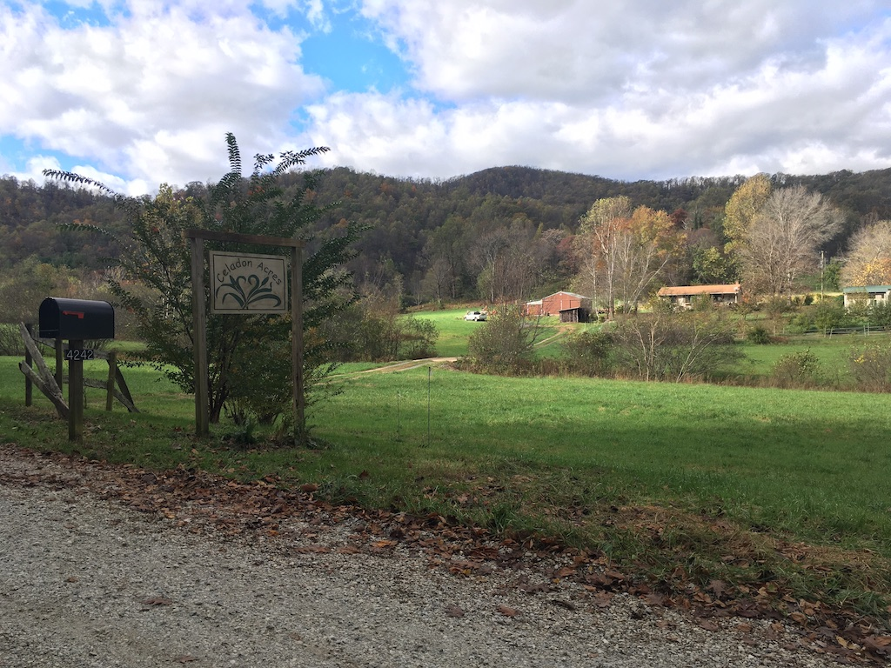
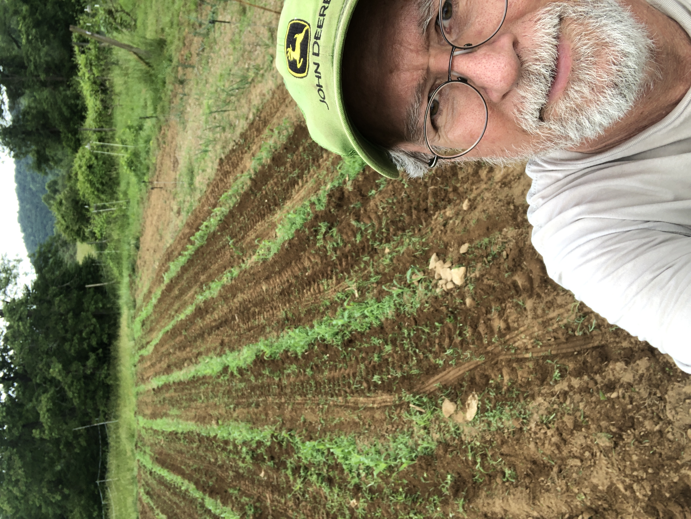
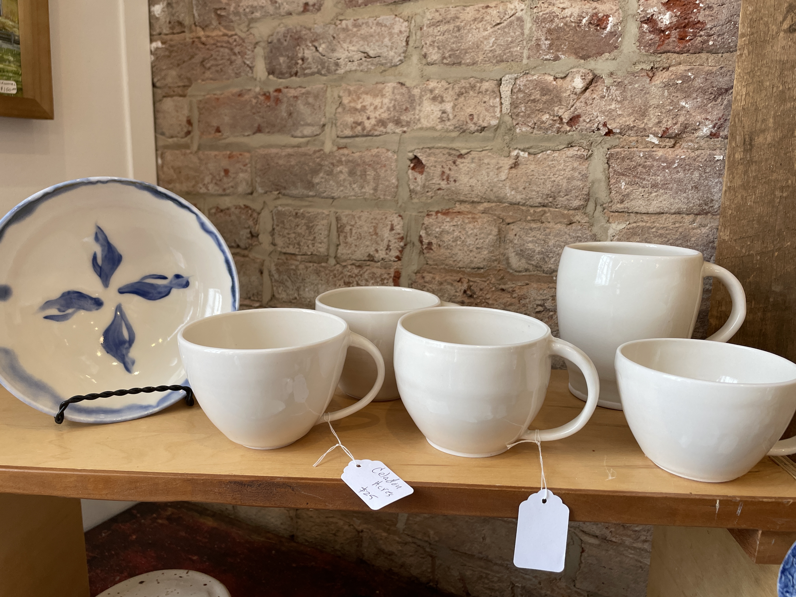

#### Buy our pottery, or cornmeal at Village Antiques and Cafe in Lovingston, Virginia

Village Antiques and Cafe\
605 Front St.\
Lovingston, VA 22949\
[Village Antiques & Cafe](https://www.villageantiquesandcafe.com/)
[Village Antiques on Facebook](https://www.facebook.com/people/Village-Antiques/61552573484394/)

Contact Abby at Celdaon Acres Farm and Pottery Studio:\
Text or call 434-465-0965\
Email <abby@laudeman.com>

Prices:

- Bloody Butcher grits, 1 pound $8.00
- Bloody Butcher cornmeal, 1 pound $8.00
- Pottery pieces priced individually

#### Cornmeal

Grown here on our farm spray free and sustainable. All our corn is open pollenated, heritage, non-GMO. Cherokee White has off-white kernels makes sweet, fluffy corn bread. Bloody Butcher has deep red kernels with a white interior. The corn meal has red flecks.

This is what the corn field looks like at the end of May.

#### Celadon Acres Pottery Studio and Gallery

We make fine ceramics and pottery in a small studio here at the farm. You can buy our pottery from the Heart of Nelson Artisan Cooperative.

[Heart of Nelson Artisan Cooperative](https://www.heartofnelson.com/)

The Heart of Nelson on Google Maps: [Heart of Nelson](https://maps.app.goo.gl/DeR9iJuQfuUL2Nkk9)

