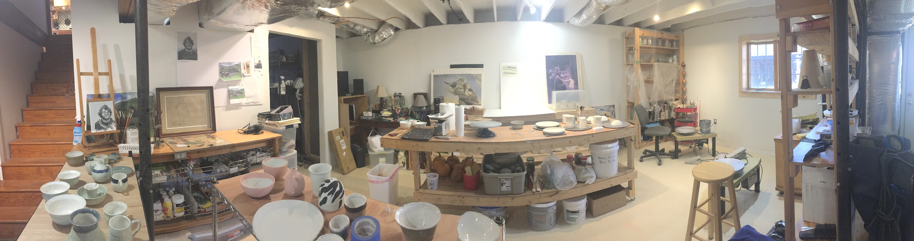
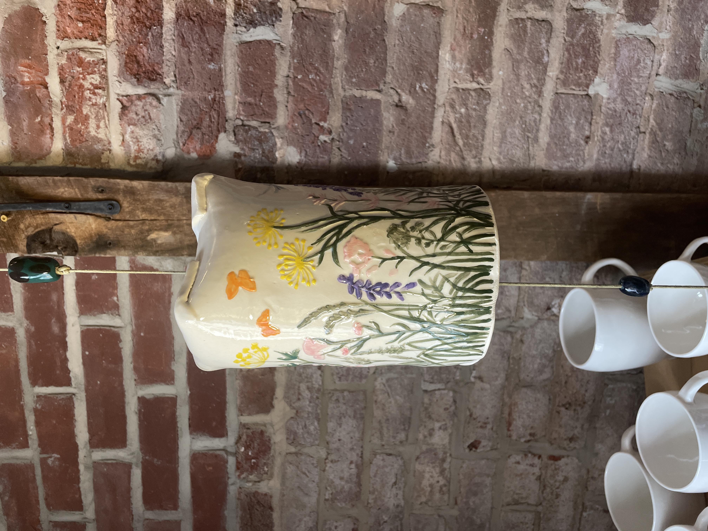
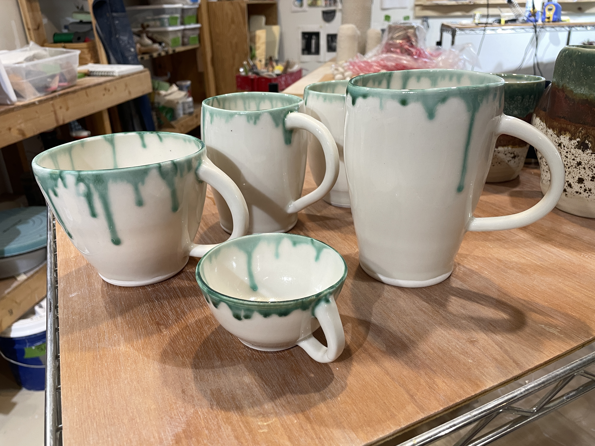
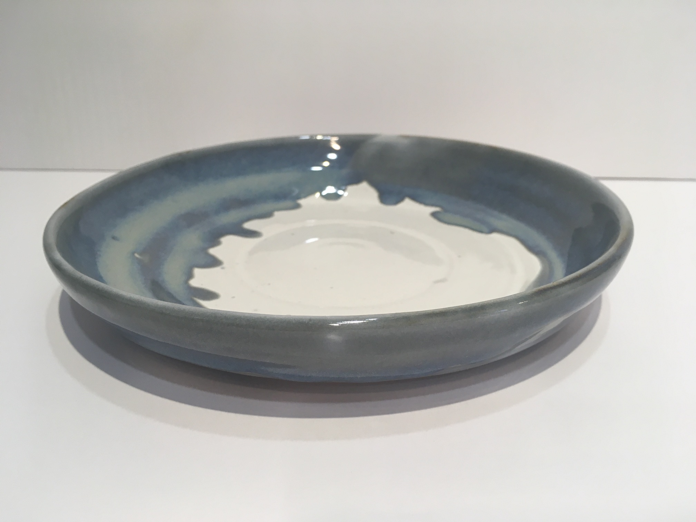
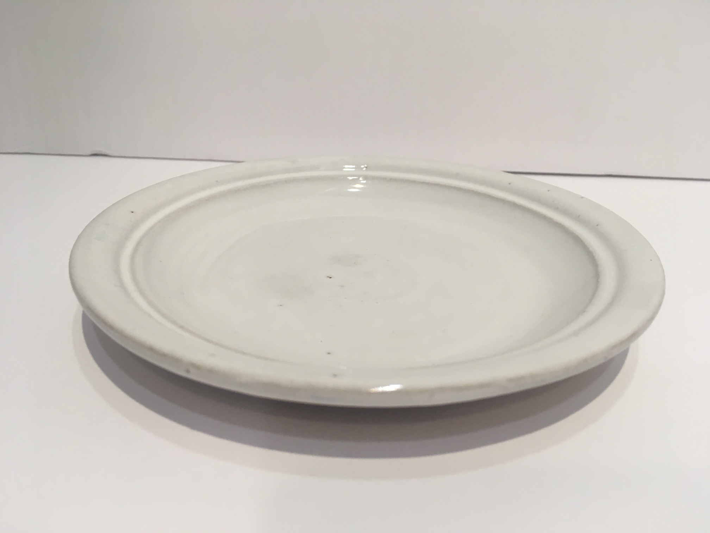

#### Celadon Acres Pottery Studio

We make fine pottery and ceramics in our small, basement studio. All pieces are individually
handmade, fired, and glazed in our studio. Abby's pieces are influenced by functional, household, pre-industrial
stoneware. Tom's pieces are primarily porcelain, influenced by the deep history of celadon in Asia.

